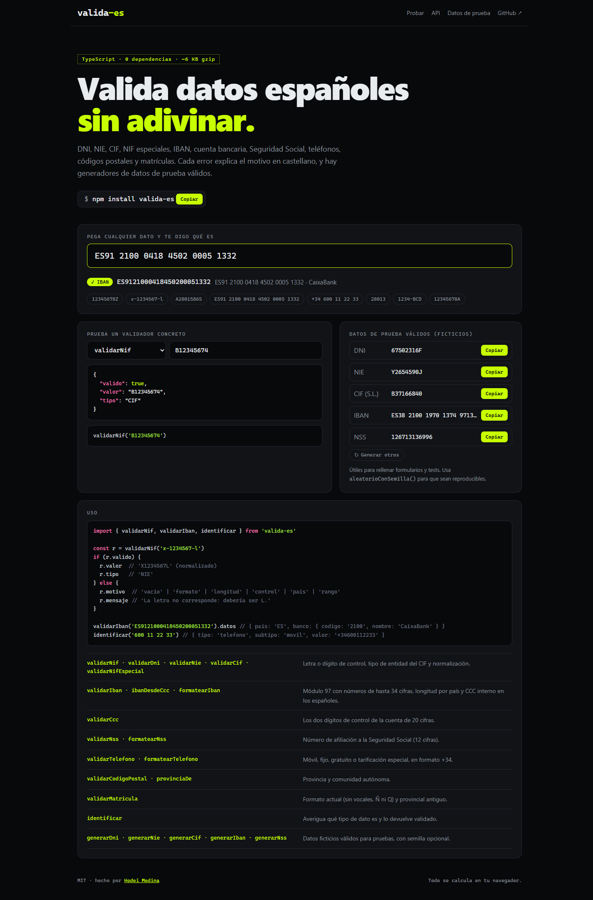

# valida-es

[](https://github.com/hodeione/valida-es/actions/workflows/ci.yml)


Validación, formato y generación de **identificadores españoles** en TypeScript, sin dependencias.

**[▶ Probar en el navegador](https://hodeione.github.io/valida-es/)**



| | Qué comprueba |
|---|---|
| **DNI, NIE, NIF K/L/M** | Letra de control (módulo 23), prefijos X/Y/Z, normaliza `12.345.678-z` → `12345678Z`. |
| **CIF** | Dígito de control, si la entidad exige letra (P, Q, R, S, N, W) o número (A, B, E, H), y el tipo de entidad. |
| **IBAN** | Módulo 97 sobre números de hasta 34 cifras, longitud por país (66 países), CCC interno en los españoles y nombre del banco. |
| **Cuenta (CCC)** | Los dos dígitos de control, módulo 11 con pesos. |
| **Seguridad Social** | Número de afiliación de 12 cifras, con las dos reglas de cálculo del control. |
| **Teléfono** | Móvil, fijo, gratuito o de tarificación especial; normaliza a `+34…`. |
| **Código postal** | Provincia y comunidad autónoma. |
| **Matrícula** | Formato actual (sin vocales, Ñ ni Q) y provincial antiguo. |

## Instalación

```bash
npm install valida-es
```

Funciona en el navegador, en Node 18 o superior, en Deno y en Bun, con `import` o `require`.

## Uso

```ts
import { validarNif, validarIban, identificar } from 'valida-es'

const r = validarNif('x-1234567-l')
if (r.valido) {
  r.valor // 'X1234567L' (normalizado)
  r.tipo  // 'NIE'
} else {
  r.motivo  // 'vacio' | 'formato' | 'longitud' | 'control' | 'pais' | 'rango'
  r.mensaje // 'La letra no corresponde: debería ser L.'
}

validarIban('ES91 2100 0418 4502 0005 1332').datos
// { pais: 'ES', banco: { codigo: '2100', nombre: 'CaixaBank' } }

identificar('600 11 22 33')
// { tipo: 'telefono', subtipo: 'movil', valor: '+34600112233' }
```

Todas las funciones `validar*` devuelven una **unión discriminada**. Si `valido` es `true`, TypeScript sabe que existen `valor` y, cuando aplica, `tipo`. Si es `false`, existen `motivo` y un `mensaje` en castellano listo para mostrar. Nunca lanzan excepciones con entradas de usuario: aceptan `unknown`.

## API

| Función | Devuelve |
|---|---|
| `validarNif(x)` | DNI, NIE, CIF o NIF especial, detectando el tipo. |
| `validarDni` · `validarNie` · `validarCif` · `validarNifEspecial` | Validación específica. `validarCif` devuelve la letra de entidad (ver `ENTIDADES`). |
| `validarIban(x)` | Con `datos.pais` y, en España, `datos.banco`. |
| `ibanDesdeCcc(ccc)` · `formatearIban(iban)` · `digitosControlIban(pais, bban)` | Construir y formatear IBAN. |
| `validarCcc(x)` · `digitoControlCcc(10cifras)` | Cuenta española de 20 cifras. |
| `validarNss(x)` · `formatearNss(x)` · `controlNss(prov, num)` | Seguridad Social. |
| `validarTelefono(x)` · `formatearTelefono(x)` | `tipo`: `movil`, `fijo`, `gratuito` o `tarificacion_especial`. |
| `validarCodigoPostal(x)` · `provinciaDe(x)` | Con `datos.provincia` y `datos.comunidad`. |
| `validarMatricula(x)` | `tipo`: `actual` o `provincial`. |
| `identificar(x)` | Qué tipo de dato es, validado, o `null`. |
| `generarDni` · `generarNie` · `generarCif` · `generarCcc` · `generarIban` · `generarNss` | Datos **ficticios** válidos para pruebas. |
| `aleatorioConSemilla(n)` | Generador reproducible (mulberry32) para los generadores. |
| `letraDni` · `digitoControlCif` · `mod97` · `limpiar` | Utilidades de bajo nivel. |

### Datos de prueba reproducibles

```ts
import { aleatorioConSemilla, generarDni, generarIban } from 'valida-es'

const rnd = aleatorioConSemilla(42)
generarDni(rnd)  // siempre el mismo con la misma semilla
generarIban(rnd) // IBAN español válido (CaixaBank por defecto)
```

## Cómo está hecho

- **Aritmética exacta sin BigInt.** El IBAN se convierte en un número de hasta 70 cifras. `mod97` lo procesa en bloques de 7 cifras, sin salir nunca del rango seguro de `Number`. Las pruebas lo comparan con `BigInt` en 2000 números aleatorios.
- **Pruebas de propiedades.** Para cada tipo se generan 1000 identificadores con semilla fija: todos deben validar, y al cambiar una cifra al azar el error debe detectarse. Así se comprueba que el control funciona de verdad, no solo con los ejemplos.
- **Datos reales.** Se usa el IBAN de ejemplo del estándar y CIF públicos, como el de una sociedad anónima y el de la Agencia Tributaria.
- **TypeScript estricto** con `noUncheckedIndexedAccess` y `exactOptionalPropertyTypes`. Se publica en ESM y CommonJS con sus tipos `.d.ts` y `.d.cts`, y `sideEffects: false` para que el empaquetador elimine lo que no uses.
- **Integración continua:** tipos, pruebas y compilación en Node 20, 22 y 24, ejecución del paquete compilado en Node 18 y cobertura mínima del 95 % de líneas.

## Desarrollo

```bash
npm install
npm test           # pruebas
npm run test:cov   # cobertura
npm run build      # dist/ en ESM, CJS y tipos
npm run demo       # demostración en local
```

## Aviso

Los validadores comprueban el **formato y los dígitos de control**, no que el documento, la cuenta o el teléfono existan ni pertenezcan a alguien. Los generadores crean datos ficticios para pruebas: no los uses para suplantar a nadie.

## Licencia

MIT © [Hodei Medina](https://github.com/hodeione)
